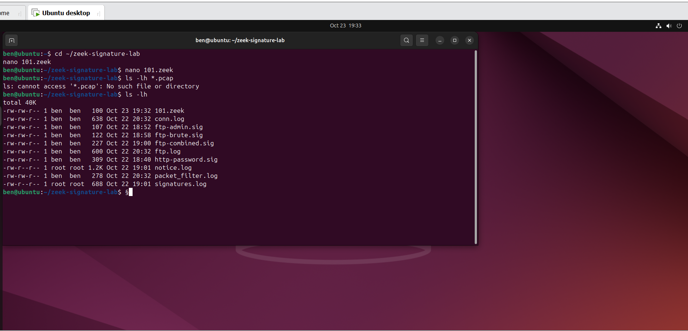
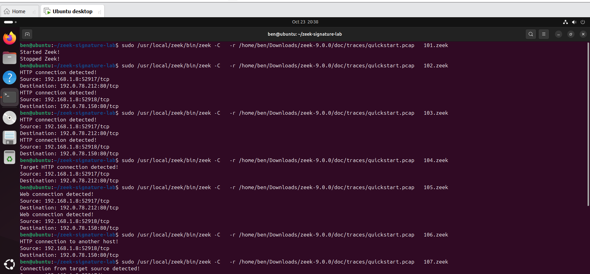
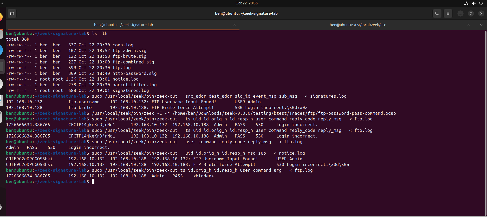

# zeek-network-security-labs

## Overview

This repository documents hands-on cybersecurity labs using **Zeek**, an open-source network security monitoring tool.

The project focuses on analyzing network traffic, writing Zeek scripts, creating signatures, and investigating security-related events through Zeek logs.

## Objectives

- Understand Zeek's event-driven scripting model.
- Analyze network traffic from PCAP files.
- Identify connections using IP addresses and port-based filters.
- Create and test custom Zeek signatures.
- Connect signature matches to custom Zeek scripts.
- Load built-in Zeek scripts and investigate generated logs.
- Explore FTP authentication failures and brute-force detection.

## Environment

- **Operating system:** Ubuntu Linux
- **Network analysis tool:** Zeek 9.0.0
- **Input:** PCAP network traffic
- **Scripting language:** Zeek
- **Terminal tools:** Bash and `zeek-cut`

## Lab 4: Zeek Scripting and Signatures

### 1. Zeek Script Lifecycle

Created scripts using `zeek_init()` and `zeek_done()` to observe when Zeek starts and finishes processing.

### 2. Connection Monitoring

Used the `new_connection()` event to inspect network connections and extract:

- Source IP address and port
- Destination IP address and port

### 3. Traffic Filtering

Implemented conditional logic to filter connections by:

- Destination port
- Source and destination IP addresses
- Multiple conditions using `&&` and `||`
- Exclusion conditions using `!=`

### 4. Signature Integration

Created an FTP-related signature to identify an FTP administrator username pattern.

Connected the signature to a custom `signature_match()` event handler and printed a message when the signature matched.

### 5. Built-in Zeek Scripts

Loaded local Zeek scripts and examined the resulting log files, including:

- `conn.log`
- `ftp.log`
- `loaded_scripts.log`
- `notice.log`
- `signatures.log`
- `stats.log`

### 6. FTP Authentication Analysis

Analyzed an FTP PCAP containing a failed login attempt.

The FTP log recorded:

- Client: `192.168.10.132`
- Server: `192.168.10.188`
- Username: `Admin`
- FTP reply code: `530`
- Reply message: `Login incorrect.`

The built-in FTP brute-force detection script was also tested. No `FTP::Bruteforcing` notice was found in the resulting `notice.log` for this capture.

A single failed login does not establish that a brute-force attack occurred.

## Example Commands

Process a PCAP file:

```bash
zeek -C -r sample.pcap
```

Load local scripts:

```bash
zeek -C -r sample.pcap local
```

Load a custom signature and script:

```bash
zeek -C -r sample.pcap -s ftp-admin.sig 201.zeek
```

Read selected fields from a Zeek log:

```bash
zeek-cut ts id.orig_h id.resp_h < conn.log
```

## Key Takeaways

- Zeek scripts can process events and apply custom logic.
- Signatures identify traffic patterns, while scripts can react to signature matches.
- Zeek logs provide different perspectives on network activity.
- Built-in detection scripts can identify suspicious patterns when the input traffic meets their detection criteria.
- Findings must be interpreted in the context of the available network evidence.

## Disclaimer

This repository is for educational and defensive cybersecurity purposes. All traffic analysis is performed on lab captures in a controlled environment.

## Status

Lab practical exercises documented. Further labs and detection experiments may be added as the project develops.

## Lab Screenshots

### Lab Environment



### PCAP Analysis



### FTP Signature Results



